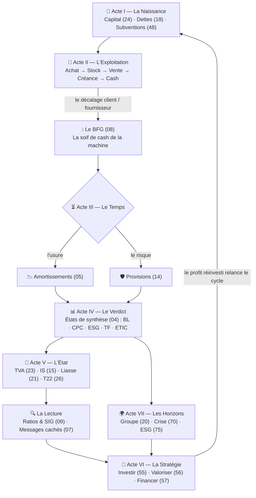

# 🧵 Le Grand Récit : De la Facture à la Stratégie

> [!abstract] Le Pitch
> Ce document est le **roman** du vault. Il relie les **71 thèmes** en une seule histoire cohérente.
> **L'idée centrale :** l'entreprise est une machine à transformer des ressources en valeur ; la comptabilité est le système nerveux qui mesure cette transformation.
> Si vous comprenez le *flux*, vous comprenez tout.
>
> 🧭 Vous voulez la **carte technique** ? → [[Le Fil Conducteur]]. 📖 Vous voulez les **mots** ? → [[📖 Lexique — Comprendre les rapports]]. Ici, vous voulez **l'histoire**.

---

## 🧭 La feuille de route : le voyage en 7 actes

| Acte | Chapitre | La question | Le livrable |
| --- | --- | --- | --- |
| 🧬 **Prologue** | Le langage universel | Comment parler ? | La grammaire (PCGE, partie double) |
| 🌱 **Acte I** | La naissance | D'où vient l'argent long ? | La structure financière |
| 🔄 **Acte II** | La vie quotidienne | Comment l'argent circule ? | Le cycle d'exploitation → le BFG |
| ⏳ **Acte III** | L'usure du temps | Quelle est la vérité ? | Le résultat « nettoyé » (clôture) |
| 📊 **Acte IV** | Le verdict | Que disent les chiffres ? | Les 5 états de synthèse |
| 🧾 **Acte V** | La négociation avec l'État | Que doit-on à l'État ? | La liasse fiscale |
| 🚀 **Acte VI** | L'avenir et la stratégie | Quel futur choisir ? | Investir · Valoriser · Financer |
| 🌍 **Acte VII** | Les horizons | Et après ? | Groupe · Crises · Modernité |

---

## 🧬 Prologue : Le Langage Universel (Fondations)

Tout commence par une règle physique simple : **rien ne se perd, rien ne se crée, tout se transforme.** C'est la **Partie Double** [[01 — Logique du PCGE & principes]].

*   Le **Bilan** (Classes 1 à 5) est une *photo* à un instant T : ce qu'on possède vs ce qu'on doit.
*   Le **CPC** (Classes 6 à 8) est le *film* de l'année : l'activité, la performance.
*   Le **Plan Comptable (PCGE)** n'est pas une liste de numéros : c'est une **grammaire** qui permet de raconter cette histoire.

> [!tip] La question du prologue
> **Comment une entreprise raconte-t-elle sa vie ?** En écrivant chaque événement deux fois (un débit, un crédit), dans un journal, puis un grand-livre, puis une balance — le **cycle comptable quotidien** [[02 — Cycle comptable quotidien]], imposé par la loi 9-88. Les [[03 — Écritures comptables types]] sont les briques du langage, la [[54 — La logique des écritures comptables]] est la méthode pour ne jamais être perdu (équation, 6 cas, 5 étapes), et [[53 — Templates d'écritures comptables]] est le dictionnaire prêt à l'emploi.

**Chaque poste du bilan est une décision passée. Chaque choix comptable est une intention.** C'est la règle d'or qui donne vie à tout le reste.

---

## 🌱 Acte I — Chapitre 1 : La Naissance (Le Premier Souffle)

Avant la première facture, il faut une **structure**. L'entreprise naît d'un contrat : [[73 — Droit des sociétés marocain (formes & gouvernance légale)]] choisit son squelette (SARL, SA, SNC…), et ce choix décide de sa transparence future.

Puis vient l'**argent long** — le circuit 3 :
1. **Les associés** apportent le capital [[24 — Capitaux propres]] (1111, primes 112x, réserve légale 1140). Les [[47 — Opérations sur capital]] racontent les augmentations et réductions : c'est l'histoire de la famille qui grandit ou se resserre.
2. **Les banques** prêtent : [[18 — Financement]] (1481, obligations 1410). ⚠️ Les intérêts des CCA (4463) ne sont déductibles que si le capital est libéré (art. 10-II-A CGI) — l'État surveille les associés qui prêtent à leur propre société.
3. **L'État** peut aider : [[48 — Subventions (exploitation, équilibre, investissement)]] — 1311 en capitaux propres assimilés, repris au rythme de l'amortissement (terrain : 10 ans).
4. Les **frais de démarrage** (frais de constitution, primes de remboursement) sont des [[11 — Non-valeurs]] : un actif *fictif*, amorti en 5 ans max, que tout analyste élimine de la vraie richesse.
5. Si l'entreprise détient déjà des participations, le portefeuille vit dans [[44 — Immobilisations financières & titres]] (2510, dividende en 7321, régime mère-fille : abattement 100 %).

> [!success] Ce que cette naissance produit
> Une **structure financière** dont la solidité se mesure par le **FRF** (financement permanent − actif immobilisé) — le premier concept de [[08 — FRF, BFG & TN (analyse dynamique)]]. Si le FRF est négatif, la machine naît déjà fragile.

---

## 🔄 Acte II — Chapitre 2 : La Vie Quotidienne (L'Exploitation)

L'entreprise se réveille. Chaque jour, le même cycle : **acheter → stocker → vendre → encaisser**.

1. **L'Achat** : on acquiert des matières (classe 6). On ne paie pas toujours tout de suite → **dettes fournisseurs** (4411). Les [[46 — RRR & emballages (rabais, remises, ristournes)]] affinent la facture : net commercial, avoirs, consignation d'emballages.
2. **Le Stock** [[22 — Stocks]] : la valeur « dort » dans l'entrepôt — c'est de l'argent immobilisé (CMUP ou FIFO, variation SF − SI).
3. **La Vente** : on facture le client (classe 7). On crée de la richesse… mais attention au **contrat à long terme** [[06 — Contrats à long terme]] : si le chantier dure 3 ans, quand reconnaît-on le chiffre d'affaires ? (À l'avancement, selon le degré d'achèvement.)
4. **Le Décalage** [[16 — Créances]] : le client ne paie pas immédiatement (3421). On peut accélérer le cash en transformant la créance en effet de commerce [[45 — Effets de commerce (LCR, BOR, escompte, protêt)]] ou en la vendant à un factor [[30 — Affacturage]].

> [!warning] Le Drame
> On a payé nos fournisseurs, mais on n'a pas encore reçu l'argent des clients. Ce décalage crée le **BFG** ([[08 — FRF, BFG & TN (analyse dynamique)]]) — la « soif » naturelle de cash de l'entreprise, qui grandit avec l'activité. La loi 32-10 [[37 — Loi 32-10 (délais de paiement)]] plafonne ce délai (60/90 jours) — et ses indemnités sont l'une des rares pénalités **déductibles** (art. 11-I CGI).
>
> **La trésorerie** [[17 — Trésorerie]] est le solde du drame : TN = FRF − BFG. Si le découvert (55) devient permanent, le BFG est financé par du court terme → fragilité.

Chaque mois s'ajoute le **mini-circuit social** : la [[50 — Paie & charges sociales 2026 (CNSS, IR, CIMR)]] (CNSS 27,83 %, IR barème 2026, CIMR) — le bulletin de paie est lui-même une histoire complète en trois écritures.

> [!tip] Le miroir interne
> En parallèle, la [[28 — Comptabilité analytique (classe 9)]] refait le film en coûts (achat, production, revient) pour savoir *quel produit* gagne vraiment — et se réconcilie avec le résultat général (98 ↔ 88).

---

## ⏳ Acte III — Chapitre 3 : L'Usure du Temps (La Clôture)

L'année se termine. Il faut arrêter les compteurs et dire la vérité : **Principe d'Indépendance des Exercices** [[13 — Régularisations de fin d'exercice]] (art. 17, loi 9-88).

*   **L'Usure** : les machines et bâtiments perdent de la valeur. On constate cet appauvrissement par les **Amortissements** [[05 — Amortissements]] (619x/28xx). *La date de départ et la durée sont des choix → levier de résultat n°1.*
*   **Le Risque** : un client risque de ne pas payer ? Un procès menace ? On anticipe la perte future avec les **Provisions** [[14 — Provisions]] (Principe de Prudence, art. 16). ⚠️ Fiscalement, une provision client n'est déductible que si elle est individualisée avec recours judiciaire (art. 10-I-F-2° CGI) → réintégration au T22.
*   **Le Nettoyage** : [[49 — Transferts de charges, clôture & réouverture]] sépare ce qui appartient à cette année de ce qui appartient à l'année prochaine (CCA, PCA, FAE, FNP — et leurs extournes obligatoires au 01/01, jamais pour les amortissements).

> [!danger] Le piège du chapitre
> CCA/PCA anormaux, provisions « lissées », amortissements « arrangés » : c'est ici, dans les écritures de clôture, que se joue l'honnêteté du résultat. Les thèses ISCAE le confirment — l'auditeur le sait.

---

## 📊 Acte IV — Chapitre 4 : Le Verdict (Les États de Synthèse)

Une fois les comptes propres, on sort les **5 documents officiels** [[04 — États de synthèse (BL, CPC, ESG, TF, ETIC)]] — le « tout indissociable » (loi 9-88 art. 9) :

1. **Le Bilan** : la santé patrimoniale (la photo).
2. **Le CPC** : la performance économique (Bénéfice ou Perte ? — le film).
3. **L'ESG** : le « film » détaillé qui explique *comment* on a créé la richesse :
    * *Marge Brute* (gains sur marchandises) → *Valeur Ajoutée* (richesse créée) → *EBE* (le cash brut d'exploitation, le cœur du réacteur) → *CAF*.
    Toute la cascade est dans [[09 — Ratios & SIG]].
4. **Le Tableau de Financement (TF)** : il explique les variations de trésorerie. D'où vient l'argent ? Où est-il allé ? (Version IFRS : [[40 — Flux de trésorerie (IFRS vs TF CGNC)]].)
5. **L'ETIC** : les notes explicatives — le procès-verbal des décisions (dérogations, changements de méthodes, tableaux B1-B10).

> [!tip] Le passage au scalpel
> L'analyste ne s'arrête pas aux chiffres publiés : il **retraite** [[10 — Retraitements (valeur comptable → valeur actuelle)]] (non-valeurs, crédit-bail, CCA…), calcule les ratios, et **lit entre les lignes** [[07 — Messages cachés (lecture entre les lignes)]] — 13 signaux d'alerte (stocks gonflés, 3424 qui grossit, découvert permanent…). Les **impôts différés** [[38 — Impôts différés]] (1351 CGNC vs IAS 12) sont un autre indice des écarts entre les deux mondes.

---

## 🧾 Acte V — Chapitre 5 : La Négociation avec l'État (Le Fiscal)

L'entreprise a calculé son résultat *comptable*. Mais l'État (DGI) a ses propres règles pour calculer l'impôt. Deux traitements, une seule vérité partagée — la **règle des deux traitements** traverse tout le vault.

*   **La TVA** [[23 — TVA]] : le détecteur de mensonges. *CA déclaré en TVA ≠ CA du CPC = l'un des deux ment.* À l'international : [[51 — TVA à l'importation & exportation]] (CAF + DAI à l'import, exonération à l'export, remboursement SIMPL 90 jours).
*   **L'IS** [[15 — Impôts (IS, IR, CM, CSS)]] : barème 2026, CM, CSS — le poids de l'État.
*   **Le Passage Fiscal** [[26 — Passage résultat comptable → fiscal]] (tableau T22) : la table de négociation.
    * *Réintégrations* : les dépenses que l'entreprise a faites mais que l'État refuse de déduire (amendes, cadeaux excessifs, provisions non admises…).
    * *Déductions* : les revenus non imposables (abattement 100 % sur dividendes, art. 6-I-C-1°).
*   **La Liasse Fiscale** [[21 — Liasse fiscale]] : les 23 tableaux que voit l'inspecteur — le rapport final.
*   **L'avenir du dialogue** : la [[36 — Facturation électronique]] (généralisation DGI 2026) numérise la piste d'audit, et les [[41 — Incitations fiscales & zones]] (ZAI, CFC, startups) offrent des trêves fiscales temporaires — à retraiter dans l'analyse.

> [!danger] Le réflexe forensique
> L'écart entre l'image fidèle et l'assiette fiscale est souvent la vérité. C'est dans le T22 que se cachent le lissage, le déguisement et la gestion du résultat.

---

## 🚀 Acte VI — Chapitre 6 : L'Avenir et la Stratégie (Finance)

L'entreprise a survécu à l'année. Maintenant, elle doit décider de son futur.

*   **Investir ?** On utilise la **VAN** et le **TRI** [[55 — Choix d'investissement (VAN, TRI, Payback)]] : un projet vaut-il plus qu'il ne coûte ? (Piège classique : oublier la variation de BFG dans les flux.)
*   **Valoriser ?** Combien vaut l'entreprise ? **ANR/ANCC**, **multiples** ou **DCF** [[56 — Valorisation d'entreprise (ANR, multiples, DCF)]].
*   **Financer ?** On arbitre dette vs capitaux propres pour optimiser le **CMPC (WACC)** [[57 — Structure de capital & CMPC (WACC)]] — le taux qui actualise tout le reste.
*   **Se réorganiser ?** [[58 — Fusions & acquisitions (M&A)]] (prime de contrôle, survaleur) et [[39 — Fusions & scissions]] (art. 161 vs 162, primes 1122/1123).
*   **Rendre ?** La [[59 — Politique de financement & dividende]] : le dividende est un message aux actionnaires (taux de distribution, RAS, signal).

> [!tip] Le pont vers l'avenir
> Tout ceci se prépare en amont par le **pilotage** : le [[65 — Budget & contrôle budgétaire (écarts)]] promet, l'écart mesure l'honnêteté de la promesse, les [[66 — Tableaux de bord & KPIs (pilotage)]] déclenchent la décision (DSO, DIO, DPO, cash forecast 13 semaines), et le [[67 — Le prévisionnel financier & le business plan]] projette la machine à 3-5 ans — le pont direct vers la valorisation (56).

---

## 🌍 Acte VII — Chapitre 7 : Les Horizons (Groupe, Crise, Modernité)

### 7.1 Quand l'entreprise grandit — le groupe
*   **Succursales** : [[31 — Comptes de liaison siège_succursales]] (rubrique 16 — ⚠️ au Maroc, pas des emprunts !).
*   **Filiales** : [[20 — Consolidation]] (3 méthodes, survaleur, intérêts minoritaires) et le comparatif [[29 — IFRS vs CGNC]].
*   **Devises** : [[25 — Devises & ECA-ECP]] — vital pour les exportateurs (agrumes, conserveries).
*   **Engagements cachés** : [[27 — Engagements hors bilan (classe 0)]] — cautions, retraites, crédit-bail [[12 — Crédit-bail]] : les bombes à retardement.
*   **Trésorerie de groupe** : [[81 — Cash pooling & trésorerie de groupe]] (mutualiser, mais attention à la contagion), couverture par dérivés [[80 — Couverture des risques financiers (dérivés)]], et ingénierie [[82 — Financements structurés & titrisation]] (FCT, SPV, sale & lease-back).

### 7.2 Quand la machine casse — la crise
*   **Les signaux** : [[71 — Diagnostic de défaillance & scoring]] lit le radar FRF → BFG → TN deux ans avant le tribunal.
*   **Les remèdes** : [[70 — Restructuration & entreprises en difficulté (Loi 73-17)]] — du mandat ad hoc confidentiel à la liquidation judiciaire.
*   **La fin** : [[52 — Dissolution & liquidation]] (boni/mali, IS de cessation sous 45 jours) et les [[19 — Cessions & réévaluation]] quand on vend des actifs pour survivre.
*   **La preuve réelle** : le cas [[43 — Cas pratique — Auto Hall S.A. (exercice 2025)]] — FRF négatif, TN −1,06 Md DH : tout le récit appliqué à une vraie entreprise marocaine.

### 7.3 La modernité — l'entreprise s'ouvre au monde
*   **Le référentiel bouge** : [[35 — Réforme comptable marocaine (convergence IFRS)]] — le CGNC converge ; les secteurs ont leurs propres plans [[32 — Plans comptables sectoriels]] (PCEC, assurances, immobilier…) et le financement participatif [[33 — Financements participatifs]] (Mourabaha, Ijara, Sukuk) apporte une alternative éthique.
*   **Le monde exige des comptes** : [[75 — ESG & reporting extra-financier (AMMC)]] — les passifs que le bilan ne provisionne pas ; la [[76 — Gouvernance d'entreprise & contrôle interne]] comme système immunitaire ; la [[79 — Fraude financière & cybersécurité]] comme nouveau champ de bataille.
*   **Le terrain** : [[42 — Application Souss-Massa]] montre le système appliqué à l'agro-export, au tourisme, à la pêche et à l'immobilier — et l'État lui-même a ses règles [[34 — Normes comptables de l'État]].

---

## 🏁 Épilogue : La Boucle Complète

> Une entreprise marocaine **naît** avec des capitaux (24) et des dettes (18) — Acte I. Elle **achète** des immobilisations qui s'amortissent (05) et un stock qui se vend (22) ; chaque vente crée une créance (16) qui devient du cash (17) — Acte II, qui dégage un **BFG** financé par le **FRF** (08). Chaque année, la **clôture** rattache, provisionne, amortit (13-14-05), produit les **5 états** (04), déclare la **TVA** (23) et l'**IS** (15) à travers la **liasse** (21) et le **T22** (26) — Actes III à V. L'analyste retraite (10), calcule (09) et lit entre les lignes (07) ; le dirigeant investit (55), valorise (56), finance (57) — Acte VI. Si elle grandit, elle consolide (20) et se couvre (25, 80) ; si elle casse, elle se restructure (70) ; si elle dure, elle rend des comptes au monde (75) — Acte VII.

**Un poste du bilan = une décision passée. Un choix comptable = une intention. Un ratio = une relation entre deux lignes.**

> [!tip] Et pour aller plus loin
> * Les **rapports fondateurs** (dossier `90 Rapports`) donnent la profondeur : méthodologie [[01 — Analyse Financière des Entreprises Marocaines (Guide Méthodologique)]], PCGE compte par compte [[02 — Le Plan Comptable Marocain (PCGE) et l'Analyse Financière]], diagnostic complet [[04 — Analyse Financière Globale (Diagnostic Complet)]], et le manuel du zéro absolu [[06 — L'Histoire que racontent les chiffres (Manuel)]].
> * Les **documents réels** (dossier `96 Documents Réels`) : CGI 2025, LF 2026, circulaires DGI, documents de référence AMMC — voir [[README — Index des documents réels]].
> * Le **graphe vivant** : `Concept Graph.canvas` (92 cartes, 710 connexions) et la [[Carte des relations — thèmes et liens]].

---

## 🗺️ La Carte Mentale du Système



---

## 📎 L'index vivant : tout ce que ce document raconte

> Ce tableau se met à jour tout seul (Dataview) : chaque lien ajouté au récit apparaîtra ici.

```dataview
TABLE WITHOUT ID
	file.link AS "Fiche",
	file.folder AS "Dossier"
FROM !"Starter-Kit"
WHERE contains(this.file.outlinks, file.link)
SORT file.folder ASC, file.name ASC
```

---

*Document maître du vault — le « roman » jumeau de [[Le Fil Conducteur]] (la carte technique). Généré le 10/08/2026. Les liens pointent vers les 71 fiches thématiques et les 6 rapports fondateurs.*
